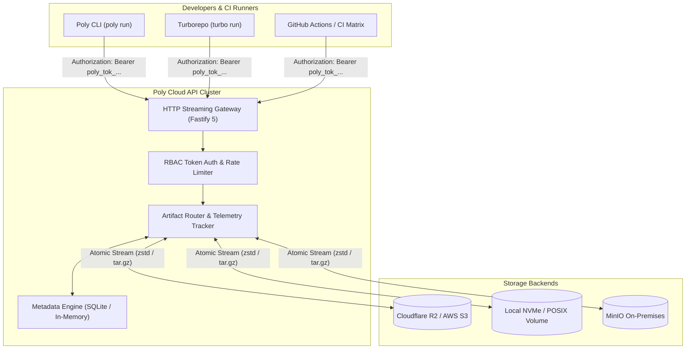

<div align="center">

# ☁️ Poly Cloud API
### Enterprise Remote Cache & Analytics Server for Polyglot Monorepos

[](https://github.com/RitualDev-Lab/poly-cloud-api/actions/workflows/ci.yml)
[](LICENSE)
[](https://www.typescriptlang.org/)
[](https://fastify.dev/)

**High-throughput, pluggable remote cache server and ROI analytics engine.**  
Seamlessly accelerates **Poly** and **Turborepo** build pipelines across distributed developer workstations and CI runners.

</div>

---

## ⚡ Highlights

- **Multi-Engine Storage Backend**: Pluggable storage supporting **AWS S3**, **Cloudflare R2**, **MinIO**, or high-speed **Local Disk / NVMe** with atomic streaming.
- **Embedded Web Dashboard & Explorer**: Live, air-gapped web console (`/dashboard`) with real-time visual ROI metrics, artifact inspection & invalidation, token management, and cluster health.
- **Turborepo & Poly Native Compatibility**: Drop-in compatible with standard Turborepo V8 artifact endpoints (`/v8/artifacts/:hash`) and native Poly build caches.
- **Enterprise Multi-Tenancy & Workspaces**: Complete logical isolation by team/workspace slug with granular storage quotas and custom retention TTLs.
- **Granular Token Governance**: Role-Based Access Control (`read`, `write`, `admin`) with expiration dates, automatic revocation, and SHA-256 secret hashing.
- **Real-Time ROI Analytics**: Quantify build hours saved, cache hit rate percentage, bandwidth transferred, and estimated dollar cost savings in CI spend.
- **Zero Memory Buffering**: Direct HTTP-to-S3 and HTTP-to-Disk streams supporting multi-gigabyte build artifacts without RAM bloat.
- **Prometheus & Health Monitoring**: Built-in `/api/v1/metrics` exporter and `/api/v1/health` deep probe for storage latency and cluster health.

---

## 📐 Architecture



---

## 🚀 Quickstart

### 1. Run with npx / CLI

```bash
# Start locally with zero configuration (uses LocalDisk storage by default)
npx @ritualdev-lab/poly-cloud-api start --port 8080

# Or start with a specific storage directory
npx @ritualdev-lab/poly-cloud-api start --port 8080 --storage local --storage-dir ./cache-data
```

### 2. Run with Docker

```bash
# Pull and start official container
docker run -d \
  -p 8080:8080 \
  -e STORAGE_BACKEND=local \
  -e DEFAULT_ADMIN_TOKEN=my-super-secret-token \
  -v poly_data:/app/data \
  --name poly-cloud \
  ghcr.io/ritualdev-lab/poly-cloud-api:latest
```

### 3. Run with Docker Compose (Turnkey MinIO S3 Stack)

```bash
git clone https://github.com/RitualDev-Lab/poly-cloud-api.git
cd poly-cloud-api
docker-compose up -d
```
The stack will boot:
- **Poly Cloud API**: `http://localhost:8080`
- **MinIO Console**: `http://localhost:9001` (User: `minioadmin`, Pass: `minioadmin`)

---

## 🛠️ Client Configuration

### Connecting Poly CLI (`poly`)

Add remote cache settings to your `poly.toml` or set environment variables:

```toml
# poly.toml
[cache]
remote_url = "https://cache.yourcompany.com"
remote_token = "env:POLY_REMOTE_CACHE_TOKEN"
team = "frontend-core"
```

Or set in your terminal or CI environment:

```bash
export POLY_REMOTE_CACHE_URL="https://cache.yourcompany.com"
export POLY_REMOTE_CACHE_TOKEN="poly_tok_..."
export POLY_TEAM="frontend-core"

# Builds will now stream cache artifacts to and from poly-cloud-api
poly run build
```

### Connecting Turborepo (`turbo`)

`poly-cloud-api` implements Turborepo's remote cache protocol out of the box:

```bash
export TURBO_API="https://cache.yourcompany.com"
export TURBO_TOKEN="poly_tok_..."
export TURBO_TEAM="frontend-core"

npx turbo run build
```

---

## 🔐 Token Management & RBAC

Issue tokens with scoped privileges:
- **`read`**: Download and probe cache hits (`GET`, `HEAD /v8/artifacts/:hash`). Ideal for PR preview environments.
- **`write`**: Upload and download artifacts (`GET`, `HEAD`, `PUT /v8/artifacts/:hash`). Ideal for main CI branches and trusted devs.
- **`admin`**: Workspace management, pruning, and token revocation.

### Create a Token via API

```bash
curl -X POST https://cache.yourcompany.com/api/v1/tokens \
  -H "Authorization: Bearer <ADMIN_TOKEN>" \
  -H "Content-Type: application/json" \
  -d '{
    "workspaceSlug": "frontend-core",
    "name": "github-actions-main",
    "role": "write",
    "expiresInDays": 90
  }'
```

Response:
```json
{
  "token": {
    "id": "c1a2f3e4-...",
    "name": "github-actions-main",
    "role": "write",
    "tokenPrefix": "poly_tok_4a8b...",
    "workspaceSlug": "frontend-core",
    "createdAt": "2026-11-16T12:00:00.000Z",
    "expiresAt": "2027-02-14T12:00:00.000Z"
  },
  "rawToken": "poly_tok_4a8b92c10ef38914ba73c49012"
}
```

---

## 📊 Enterprise Analytics & ROI

Query real-time productivity and infrastructure savings:

```bash
curl https://cache.yourcompany.com/api/v1/workspaces/frontend-core/stats \
  -H "Authorization: Bearer <TOKEN>"
```

Response:
```json
{
  "stats": {
    "workspaceSlug": "frontend-core",
    "totalArtifacts": 1420,
    "totalSizeBytes": 48234901230,
    "quotaBytes": 107374182400,
    "quotaUsedPercent": 44.9,
    "totalHits": 18450,
    "totalMisses": 2100,
    "hitRatePercent": 89.8,
    "totalDurationSavedSeconds": 248920,
    "estimatedSavingsUsd": 553.16
  }
}
```

---

## 🌐 API Reference

| Method | Endpoint | Description | Auth Required |
|:-------|:---------|:------------|:--------------|
| `GET` | `/dashboard` | Live Web Console & Artifact Explorer | Public (or Bearer Token) |
| `GET` | `/v8/artifacts/:hash` | Download cached binary artifact | `read` |
| `HEAD` | `/v8/artifacts/:hash` | Check artifact hit/miss status | `read` |
| `PUT` | `/v8/artifacts/:hash` | Upload artifact binary stream | `write` |
| `DELETE` | `/v8/artifacts/:hash` | Invalidate artifact | `write` |
| `POST` | `/v8/artifacts/events` | Record build task telemetry | `write` |
| `GET` | `/api/v1/health` | Service & storage health probe | Public |
| `GET` | `/api/v1/metrics` | Prometheus metrics exporter | Public |
| `GET` | `/api/v1/workspaces` | List all workspaces | `admin` |
| `POST` | `/api/v1/workspaces` | Create / configure workspace | `admin` |
| `GET` | `/api/v1/workspaces/:slug/stats` | Workspace ROI & cache hit stats | `read` |
| `GET` | `/api/v1/workspaces/:slug/artifacts` | List artifacts with pagination | `read` |
| `POST` | `/api/v1/workspaces/:slug/prune` | Evict expired artifacts | `admin` |
| `POST` | `/api/v1/tokens` | Issue a scoped API token | `admin` |
| `GET` | `/api/v1/tokens` | List workspace tokens | `admin` |
| `DELETE` | `/api/v1/tokens/:id` | Revoke an API token | `admin` |

---

## ⚙️ Environment Variables

| Variable | Default | Description |
|:---------|:--------|:------------|
| `PORT` | `8080` | Port to bind server |
| `HOST` | `0.0.0.0` | Network interface to bind |
| `STORAGE_BACKEND` | `local` | `local`, `s3`, or `memory` |
| `STORAGE_LOCAL_DIR` | `./data/artifacts` | Root directory for local disk storage |
| `S3_BUCKET` | `poly-remote-cache` | S3 / R2 Bucket name |
| `S3_REGION` | `us-east-1` | S3 region |
| `S3_ENDPOINT` | *(none)* | Custom endpoint (e.g. Cloudflare R2 or MinIO) |
| `S3_ACCESS_KEY_ID` | *(none)* | S3 access key |
| `S3_SECRET_ACCESS_KEY` | *(none)* | S3 secret key |
| `METADATA_DB_PATH` | `./data/metadata.sqlite` | SQLite database file location |
| `AUTH_ENABLED` | `true` | Enable Bearer token authentication |
| `DEFAULT_ADMIN_TOKEN` | *(auto)* | Master cluster administrator token |
| `MAX_ARTIFACT_SIZE_BYTES`| `2147483648` (2GB) | Maximum single artifact size |
| `COMPUTE_COST_PER_HOUR_USD`| `0.08` | Runner cost per hour for ROI calculation |

---

## 🧪 Testing & Verification

```bash
# Run unit & integration test suite (36 tests)
npm test

# Run Biome formatting & linter verification
npm run check

# Compile TypeScript production bundle
npm run build
```

---

## 📜 License

Licensed under the [Apache License, Version 2.0](LICENSE).  
Copyright © 2026 [RitualDev-Lab](https://github.com/RitualDev-Lab).
